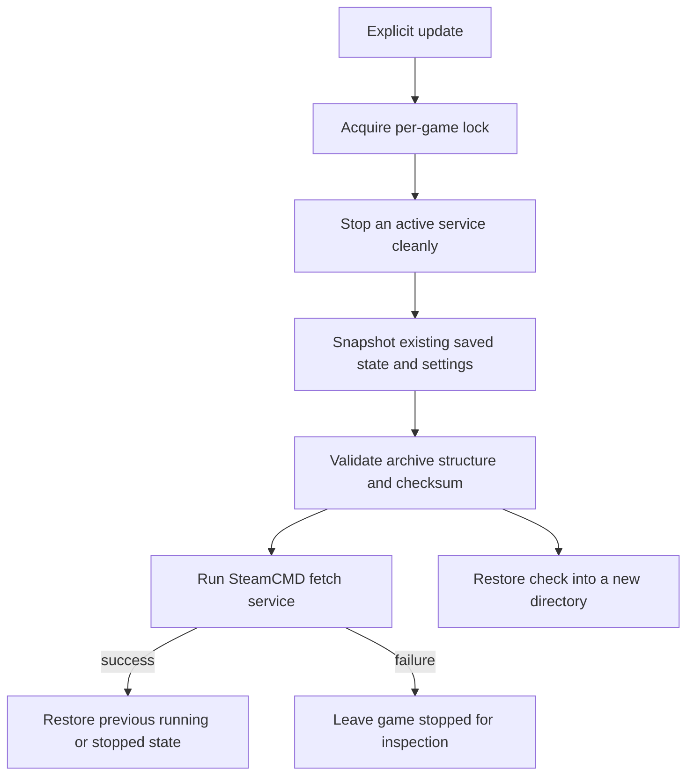

# Anq Server Deploy: deliberate game-server operations

The original project combined NixOS game services, remote sync and destructive
host installation. This clean remake focuses on an existing NixOS host: configure
one service, install/update it deliberately, and retain a usable saved-state
snapshot before making a change. The archived working tree remains untouched.

## Implementation

A small catalog describes each game's download identity, launch type, settings
location, ports and snapshot paths. One NixOS module generates distinct users,
state directories, credentials, main services and SteamCMD fetch services. Shared
Bash operations coordinate updates/backups; Python validates/extracts archives.
Nixpkgs 26.05 is pinned for the project's checks and packaged tools.

There is no web UI. The interface is the Nix configuration, systemd, game-ops and
an operations guide. Windows servers use an individual Wine prefix and automatic
X display; the native server has an FHS launcher. Settings remain host files
outside the repository/Nix store and enter services as systemd credentials.

## Update and recovery boundary

An initial installation with no saved state can fetch without a snapshot. An
explicit backup with nothing to archive fails. Snapshots reject symlinks/special
files that the restore checker could not safely extract. Update failure leaves
potentially modified binaries stopped, while a backup failure can restart the
unchanged service. Restore checks never overwrite the live world.

These are saved-state backups, not binary-version rollbacks. They are local and
unencrypted, and may contain passwords. Off-host storage, retention and an actual
world recovery check remain deployment responsibilities. A checksum detects
accidental corruption rather than a malicious administrator.

## Verification

The module evaluation check exercises all three configured game services and
checks users, credential paths, hardening, opt-in start/firewall and rejection of
store-backed secrets. Ten operational tests cover running/stopped state,
backup/fetch failures, unclean stops, command validation, locks, corruption,
unsafe archive entries and restore extraction.

A NixOS VM boots actual systemd and starts all three generated service launch
paths with fixture executables. It checks private runtime settings and ownership,
backups for all three games, a Palworld-layout extraction drill, successful
updates, failed-update stop behavior, retained save bytes and explicit recovery.
The fixture replaces SteamCMD, Wine, steam-run and the actual games. The VM and
all flake checks passed locally; no workstation or VPS activation was performed.

## Limits

Real game downloads, native/Wine compatibility, client joins, public discovery,
load capacity and recovery of a real world have not been verified for this
remake. Upstream game/configuration changes remain independent of NixOS. The
module's local v1 evidence concerns service and operations mechanics, not a claim
of vendor-certified hosting or production game availability.
